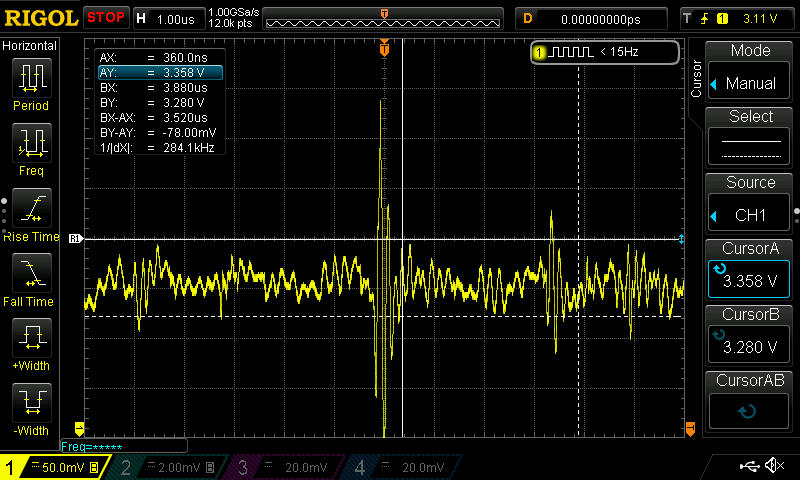

# Raspberry Pi CM4 3.3V Power Integrity & PDN Anti-Resonance Analysis

A hardware-in-the-loop (HIL) validation and LTspice simulation framework investigating high-frequency voltage transient excursions and anti-resonance peaks on the 3.3V power delivery network (PDN) during active processor workloads on a Raspberry Pi Compute Module 4 (CM4) carrier board.

---

## 🛠️ Hardware Testbench & Instrumentation
* **Platform:** Raspberry Pi Compute Module 4 (CM4) carrier board
* **Workload:** High-di/dt execution loops and instruction bursts
* **Instrumentation:** 
  * Rigol digital storage oscilloscope
  * High-bandwidth active/differential probing
  * LTspice circuit simulation framework

---

## 📊 Empirical Findings & Scope Capture
* **Time-Domain Ringing:** Active workload execution on the CM4 induced repetitive transient bursts, reaching a peak-to-peak excursion envelope of **~170 mV to 190 mV**.
* **Frequency Isolation:** Using oscilloscope cursor interval measurements ($\Delta X = 3.520\,\mu\text{s}$), the dominant ringing frequency was isolated at **284.1 kHz**—tracing back to LC interaction between bulk decoupling capacitance and trace loop inductance.

---

## ⚡ LTspice Simulation & Correlation
1. **Small-Signal AC Impedance (`.ac`):**
   * Modeled bulk ceramic capacitors (`C2`, `C3` = 10 µF) and equivalent decoupling branches (`L4`, `C1`).
   * Identified a high-Q anti-resonance impedance peak at **284 kHz**.
2. **ESR & Damping Calibration:**
   * Tuned series resistance (`R1`, `R2`, and `R6` set to $5\,\text{m}\Omega$) to scale the simulated peak transfer impedance down to **$78\,\text{m}\Omega$**, matching real-world electrical losses observed on the bench.
3. **Time-Domain Transient Response (`.tran`):**
   * Driven with a high-di/dt step current source ($\Delta I = 1.32\,\text{A}$ with $40\,\text{ns}$ edges).
   * Successfully reproduced the dual-polarity ringing envelope ($\sim 178\,\text{mV}$ peak-to-peak), verifying strong alignment between the circuit model and empirical scope captures.

---

## 🚀 Engineering Impact & Next Steps
* **Root Cause Confirmation:** Proved that fast software workloads trigger constructive superposition across the 284 kHz anti-resonance node, sustaining high-amplitude voltage noise during execution.
* **Predictive Testbench:** Established a robust simulation baseline for evaluating layout modifications, targeted damping networks, and capacitor redistribution strategies to ensure power rail reliability.

* 
* 

# Raspberry-Pi-CM4-3.3V-PDN-Anti-Resonance-Transient-Validation
Raspberry Pi CM4 3.3V PDN Anti-Resonance &amp; Transient Validation
